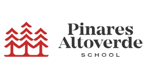

# 🌲 Pictogramas · Pinares Altoverde School

Herramienta web de apoyo visual para docentes: convierte cualquier palabra u oración en pictogramas y permite escucharla en voz alta. Pensada para aulas de comunicación aumentativa y alternativa (CAA).



## ✨ Características

- **Oración → pictogramas**: cada palabra se busca automáticamente en la [API de ARASAAC](https://arasaac.org) y se muestra como una tarjeta ilustrada.
- **Alternativas de pictograma**: si una palabra tiene varios resultados posibles, se puede hacer clic en la tarjeta para ir alternando entre ellos.
- **Lectura en voz alta**: usa la Web Speech API del navegador y elige automáticamente la mejor voz en español disponible en el dispositivo (con opción de elegir voz y velocidad manualmente).
- **Frases frecuentes**: chips de acceso rápido con oraciones habituales en el aula ("tengo hambre", "necesito ayuda", "estoy feliz"...).
- **Modo impresión**: al imprimir solo se muestra la tira de pictogramas, lista para usar en papel.
- **Diseño accesible**: alto contraste, tipografía clara, `prefers-reduced-motion` respetado y navegación por teclado.

## 🖥️ Demo / Uso

1. Escribe una palabra o una oración completa en el campo de texto (por ejemplo: *"Hoy quiero jugar en el patio con mis amigos"*).
2. Pulsa **Ver pictogramas** o elige una de las frases frecuentes.
3. Pulsa **🔊 Leer en voz alta** para escuchar la oración.
4. Pulsa **Imprimir** para obtener una versión en papel de la tira de pictogramas.

## 🛠️ Tecnologías

- HTML5 / CSS3 / JavaScript (vanilla, sin frameworks ni dependencias de build)
- [API de pictogramas de ARASAAC](https://arasaac.org/developers) para la búsqueda de imágenes
- [Web Speech API](https://developer.mozilla.org/es/docs/Web/API/Web_Speech_API) para la síntesis de voz
- Google Fonts: *Bitter*, *Work Sans*, *JetBrains Mono*

## 📁 Estructura del proyecto

```
.
├── index.html      # Estructura de la página
├── style.css       # Estilos (paleta e identidad visual del logo)
├── script.js       # Lógica: búsqueda de pictogramas y lectura en voz alta
└── logo.png         # Logotipo del colegio
```

## 🚀 Cómo ejecutarlo localmente

No requiere instalación ni dependencias. Basta con abrir `index.html` en un navegador, o servirlo con cualquier servidor estático:

```bash
# Opción rápida con Python
python3 -m http.server 8000
```

Luego visita `http://localhost:8000`.

> **Nota:** la lectura en voz alta depende de las voces instaladas en el sistema/navegador del usuario, por lo que la disponibilidad de voces en español puede variar entre dispositivos.

## ⚠️ Limitaciones conocidas

- Requiere conexión a internet para consultar la API de ARASAAC.
- La calidad y disponibilidad de voces en español depende del navegador y sistema operativo.
- Las palabras sin pictograma disponible se muestran con un icono genérico (✎).

## 🙏 Créditos

- Pictogramas de [ARASAAC](https://arasaac.org) (Gobierno de Aragón), bajo licencia [CC BY-NC-SA 4.0](https://creativecommons.org/licenses/by-nc-sa/4.0/). Autor: Sergio Palao. Procedencia: ARASAAC.org.
- Desarrollado para **Pinares Altoverde School**.

## 📄 Licencia

Este proyecto se distribuye bajo licencia [MIT](LICENSE) (o especifica la que prefieras). El uso de los pictogramas de ARASAAC está sujeto a su propia licencia CC BY-NC-SA, que **no permite uso comercial**.
